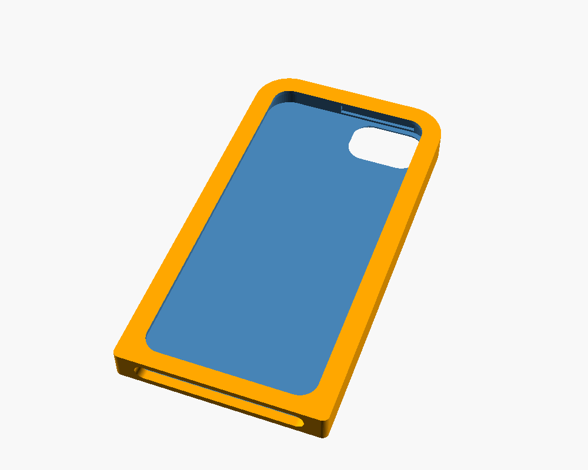
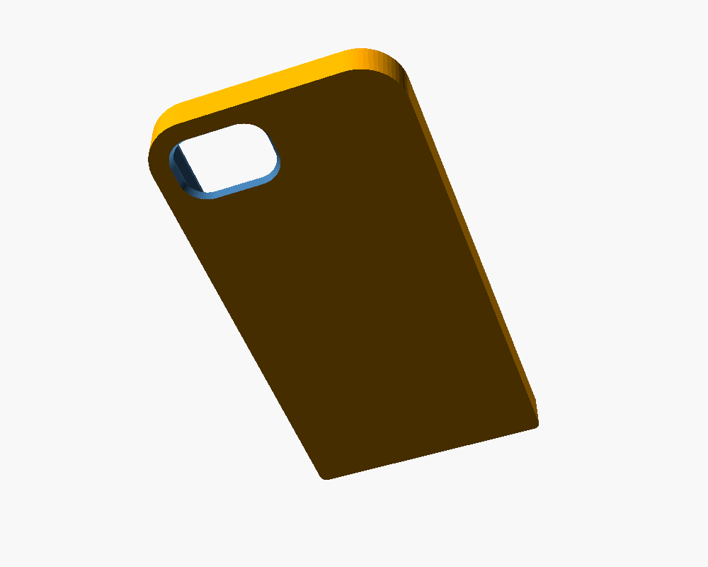
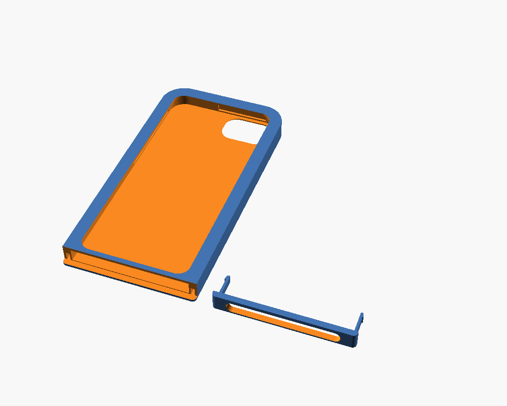

# iPod touch 6 – Lock-Case für Alarmy

Ein Case, das den Power-Knopf komplett abdeckt. Dann kannst du den iPod nicht ausschalten, während der Alarmy-Wecker klingelt.

| Vorne | Hinten | Druckplatte |
|---|---|---|
|  |  |  |

## Was das Case macht

- **Power-Knopf (Oberkante rechts): komplett geschlossen.** Innen ist eine Freitasche. Auch wenn man fest aufs Case drückt, löst der Knopf nicht aus.
- **Lautstärketasten (links): standardmäßig abgedeckt**, damit man den Wecker nicht leiser drehen kann. Mit `vol_open = true` werden sie freigelegt.
- **Frei bleiben:** Rückkamera und Blitz, Display, Home-Button, Frontkamera, Lightning-Buchse, Kopfhörerbuchse und Lautsprecher.
- **Nicht zu öffnen:** Der Deckel an der Unterkante hat zwei Schnappzungen. Sie rasten in Kammern *innerhalb* der Seitenwände ein. Von außen kommt man an keinen Haken heran. Nach dem Einrasten bekommt man den iPod nur wieder heraus, wenn man das Case zerstört (zersägen oder aufbrechen).

Außenmaße: 67,2 × 130,8 × 9,5 mm

## Dateien

| Datei | Inhalt |
|---|---|
| `stl/schale.stl` | Hauptteil: Rücken, Seiten, Oberkante, Frontrahmen |
| `stl/deckel.stl` | Deckel für die Unterkante mit den Schnappzungen |
| `ipod_touch6_lockcase.scad` | Parametrische Quelle (OpenSCAD) für eigene Anpassungen |

## Drucken (Bambu Lab A1 mini)

- **Material:** PETG ist empfohlen, weil es zäh ist und die Schnappzungen nicht brechen. PLA geht auch.
- **Ausrichtung:** Beide Teile so drucken, wie die STL sie liefert: Rückseite nach unten. Die Zungen des Deckels liegen dann flach auf dem Bett. So biegen sie entlang der Schichten und brechen nicht.
- **Stützstrukturen:** keine nötig.
- **Schichthöhe:** 0,16 mm (für genaue Kanäle), mindestens 3 Wandlinien, 20 % Infill.
- **Elefantenfuß-Kompensation** einschalten (z. B. 0,15 mm), sonst klemmt der Deckel auf dem Absatz.

## Erst testen, dann verschließen

1. **Erst nur die Schale drucken.** iPod von unten einschieben, ohne den Deckel.
2. Prüfen:
   - Ist die Kamera frei? Ein Foto machen und auf schwarze Ränder achten.
   - Lässt sich der Power-Knopf durchs Case **nicht** auslösen?
   - Passt das Ladekabel?
3. Wenn alles passt: Deckel drucken, Lightning-Öffnung auf die Buchse ausrichten und kräftig eindrücken, bis es zweimal **klickt**.
4. Wer ganz sicher gehen will, gibt vorher einen Tropfen Sekundenkleber auf die Kontaktfläche des Deckels.

> ⚠️ Nach dem Klick geht das Case nicht mehr zerstörungsfrei auf. Den iPod vorher vollständig einrichten (WLAN, Alarmy, Weckzeiten) und aufladen.

## Anpassen

Die Positionen von Kamera und Power-Knopf beruhen auf Apple-Maßen bzw. sind geschätzt. Am besten einmal mit dem Lineal nachmessen und in der `.scad` korrigieren. Dann in OpenSCAD `part = "tray"` bzw. `"cap"` setzen und mit F6 und *Export STL* neu exportieren.

| Parameter | Bedeutung |
|---|---|
| `clr` | Spiel seitlich. Ist der iPod zu stramm, auf 0.4 erhöhen. |
| `cam_x_from_edge`, `cam_y_from_top` | Kamera-Ausschnitt in mm vom rechten Rand bzw. von der Oberkante (von vorne gesehen) |
| `pwr_x_from_edge` | Bereich der Power-Knopf-Freitasche |
| `vol_open` | `true` = Lautstärketasten frei |
| `port_h`, `port_margin` | Größe der Öffnung an der Unterkante. Bei dicken Kabelsteckern `port_h` vergrößern. |

## Zusätzlicher Tipp: Geführter Zugriff

Das Case blockiert nur den Power-Knopf. Den Home-Button bzw. App-Wechsel blockiert es nicht. Damit man Alarmy auch nicht einfach schließen kann, iOS-Funktion **Geführter Zugriff** einschalten:
*Einstellungen → Allgemein → Bedienungshilfen → Geführter Zugriff*. Danach in Alarmy dreimal Home drücken und starten. Unter *Optionen* kann man dort zusätzlich die Standby-Taste und die Lautstärketasten deaktivieren.
